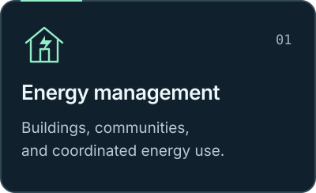
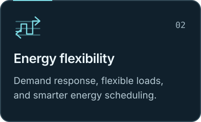
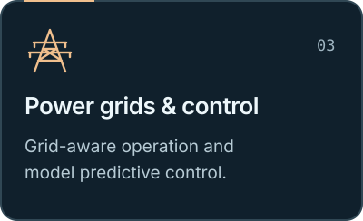

  

<h2 align="center">Energy systems. Intelligent decisions.</h2>

  I work on <b>energy management</b>, <b>energy flexibility</b>, and <b>power grids</b>, 
  connecting buildings and energy communities through modelling, optimization, and control.

  
  

  <a href="#focus-areas">Focus areas</a> &nbsp; · &nbsp;
  <a href="#selected-work">Selected work</a> &nbsp; · &nbsp;
  <a href="#research-directions">Research directions</a>

 

## Focus areas

  
  
  

 

## Selected work

| Project | What you'll find |
| :--- | :--- |
| **[Energy Management · Python](https://github.com/BehnamMohseniGharyehsafa/Energy_Management_Python)** | Python code and notebooks for exploring energy management. |
| **[Building Community Energy Flows](https://github.com/BehnamMohseniGharyehsafa/buildingCommunityEnergyFlowSimulation)** | Community-scale energy simulation, building models, and workflows connecting OpenStreetMap, Dragonfly, and URBANopt. |

 

## Research directions

Turning energy data into coordinated decisions, from individual buildings to connected communities.

- **Economic model predictive control**: harnessing energy flexibility at community scale. [Repository in development ↗](https://github.com/BehnamMohseniGharyehsafa/Economic-Model-Predictive-Control-in-Harnessing-Energy-Flexibility-at-Community-Scale)
- **Flexibility-aware techno-economic analysis**: exploring the relationship between flexible operation and energy-system economics. [Repository in development ↗](https://github.com/BehnamMohseniGharyehsafa/Flexibility-Aware-Techno-Economic-Analysis)

  

 

  <b>From individual buildings to a more flexible power grid.</b> 
  Energy management &nbsp; / &nbsp; Energy flexibility &nbsp; / &nbsp; Intelligent control

